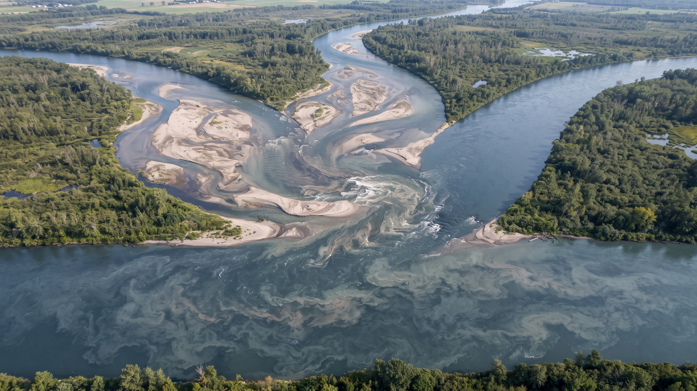
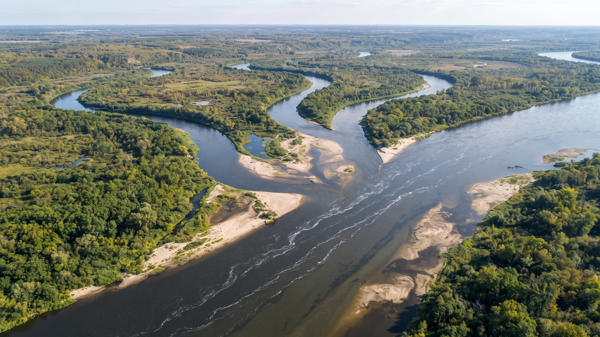
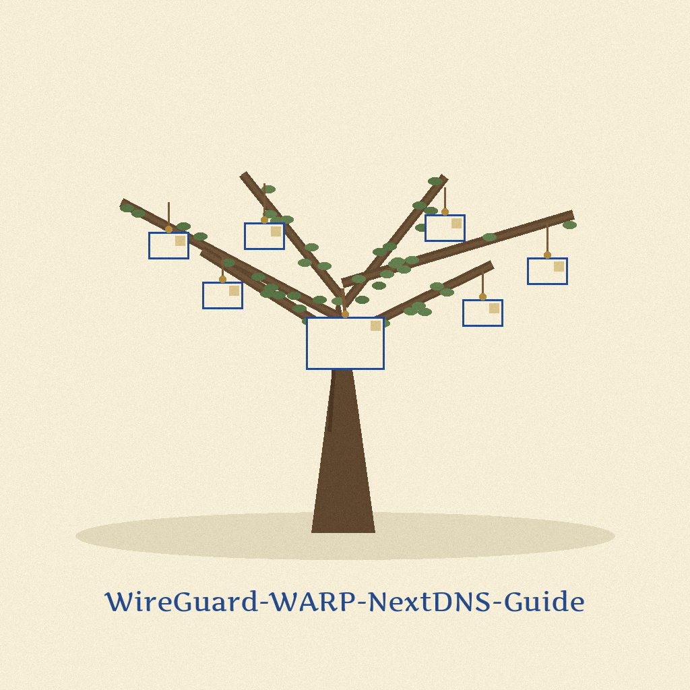

# WireGuard-WARP-NextDNS-Guide



<p align="center"></p>


## What this repo is

I keep these links and this one install command together as my own reference for a single setup: WireGuard running with WARP, with NextDNS for DNS. This repo is that reference note. It is not a script and it does not configure anything by itself.


## Setup reference

The first link is the guide I follow for the whole setup. The second link is a wgcf issue I needed while working through it, and wgcf is part of getting the WARP side running, so I install it with brew as part of the same setup and not as a separate project.

- Guide: [WireGuard Full Power with WARP and NextDNS](https://gcqd.fr/22/07/04/Wireguard-full-power-with-warp-and-nextdns)
- [wgcf issue #279](https://github.com/ViRb3/wgcf/issues/279)

```bash
brew install wgcf
```

The links and the command are reproduced exactly as written. They were
not re-run in this pass, and the guide and issue pages were not
re-checked in a browser.


